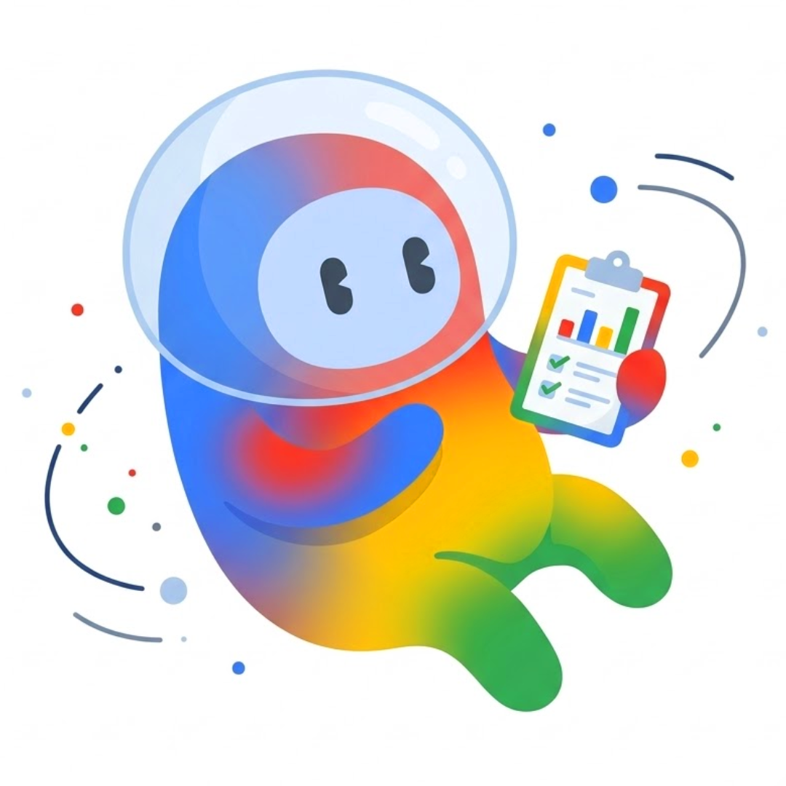
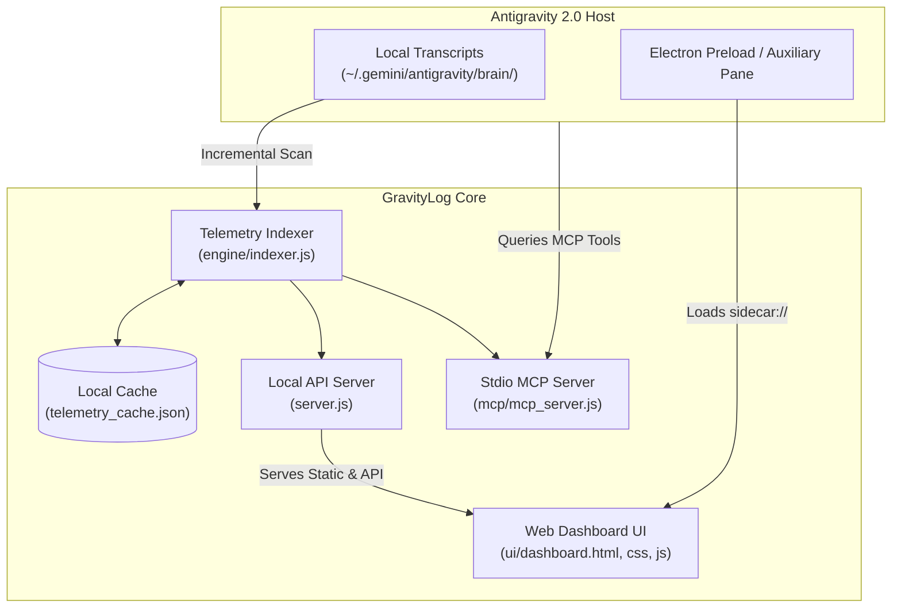

<p align="center">
  
</p>

<h1 align="center">GravityLog</h1>

<p align="center">
  <b>Native Usage Analytics, Token Consumption Tracker & 365-Day Activity Heatmap for Antigravity 2.0</b>
</p>

<p align="center">
  <a href="#license"></a>
  <a href="https://nodejs.org/"></a>
  <a href="#antigravity-compatibility"></a>
  <a href="#model-context-protocol-mcp"></a>
  <a href="#platform"></a>
</p>

---

## 🚀 Overview

**GravityLog** is a lightweight, production-grade usage analytics engine and native UI extension designed specifically for the **Google Antigravity 2.0** desktop app on Windows.

It delivers real-time visibility into your AI coding workflows by aggregating local conversation transcripts, token counters, model distributions, and daily habits into a clean, Google-styled dashboard that integrates directly into Antigravity's chrome, sidebar panes, and AI agent skills.

---

## ✨ Features

### 🌓 Dual-Theme System (Light & Dark)
- **100% Native Styling**: Automatically matches Antigravity's sleek aesthetic.
- **Reference Light Mode**: Crisp white surfaces (`#ffffff`), subtle borders (`#e2e8f0`), soft blue/emerald/amber icon badges, and high-contrast typography.
- **Dark Mode**: Elevated zinc surfaces (`#18181b`), subtle dark borders, and cyan/purple accents.
- **Persistent Toggle**: Switch themes instantly via the header toggle button; preference persists in `localStorage`.

### 📊 Bento KPI Summary Row
1. **Total Requests**: Lifetime completion requests count, today's delta badge (`+X today`), and total user messages/prompts sent.
2. **Total Tokens & Explicit Breakdown**:
   - Total volume formatted adaptively (e.g., `115.1M` or `840K`).
   - **Explicit Input/Output Rows**: Dedicated, clearly visible input and output token counts directly inside the card—no hidden hover tooltips required.
3. **Most Used Model**: Top AI model by token consumption with percentage share badge.
4. **Active Streak**: Consecutive days of coding activity alongside your all-time longest streak.

### 📅 365-Day GitHub-Style Activity Heatmap
- Full 52/53-week × 7-day contribution grid displaying month labels (`Jan`–`Dec`) and day labels (`Mon`, `Wed`, `Fri`).
- 5 distinct activity intensity levels (0 to 4) themed with Google Material 3 accents.
- **Interactive Tooltip**: Hover over any calendar square for exact statistics (`"48 requests • 142,300 tokens on Oct 16, 2026"`).
- **Timeframe Filtering**: Toggle instantly between `Today`, `1 Week` (`1w`), `30 Days` (`30d`), `90 Days` (`90d`), and `All Time` (`all`).

### 🥧 Multi-Model Distribution
- Segmented, rounded progress bar showing proportional usage across all AI models (Gemini 3.8 Flash, Gemini 3.8 Pro, Claude 3.5 Sonnet, Claude 3.7 Sonnet, GPT-4o, and local models).
- Itemized breakdown showing per-model request counts, token volumes, and market share percentages.

### ⚡ Incremental Telemetry & Background Indexer
- Scans conversation transcripts in `%USERPROFILE%\.gemini\antigravity\brain\` incrementally.
- Cached via mtime/size checks in `telemetry_cache.json` for zero-lag performance.
- Works offline and requires zero external cloud dependencies.

### 🧪 Sample Data Preview Switch
- Toggle "Preview Sample Data" at any time from the dashboard footer to instantly preview the complete dashboard with realistic sample data even on fresh Antigravity installations.

### 📥 One-Click Telemetry Export
- Export your full activity dataset instantly as structured **JSON** or spreadsheet-ready **CSV**.

---

## 🏛️ Architecture



---

## 📦 Project Structure

```text
D:\Project\GitGravity\
├── GravityLog-logo.png            # Official GravityLog mascot logo
├── plugin.json                    # Antigravity 2.0 plugin manifest
├── package.json                   # NPM configuration, dependencies & scripts
├── mcp_config.json                # Model Context Protocol registration
├── server.js                      # Local HTTP API & static asset server
├── install.ps1                    # Automated Windows PowerShell installer
├── uninstall.ps1                  # Clean removal & restoration script
├── test.js                        # Automated test suite (33 assertions)
├── asar_patcher.py                # Optional Electron preload patch utility
├── LICENSE                        # MIT License
├── README.md                      # Documentation
├── engine/
│   ├── indexer.js                 # Transcript parser, token aggregator & streaks
│   └── telemetry_cache.json       # Incremental cache file
├── mcp/
│   └── mcp_server.js              # JSON-RPC 2.0 MCP server for Antigravity AI
├── sidecars/
│   └── usage-analytics/
│       ├── sidecar.json           # Antigravity UI sidecar manifest
│       └── index.js               # Sidecar process loader
├── skills/
│   └── usage-analytics/
│       └── SKILL.md               # AI agent prompt integration & documentation
└── ui/
    ├── dashboard.html             # Standalone dashboard HTML template
    ├── dashboard.css              # Dual-theme (Light/Dark) stylesheet
    ├── dashboard.js               # Interactive UI controller & chart renderer
    └── injector.js                # Electron native modal injector
```

---

## 📥 Installation

### Method 1: Automated 1-Click Installer (Recommended)

1. Clone or download this repository:
   ```bash
   git clone https://github.com/your-username/GitGravity.git
   cd GitGravity
   ```

2. Run the automated PowerShell installer:
   ```powershell
   powershell -ExecutionPolicy Bypass -File install.ps1
   ```
   *Or with NPM:*
   ```bash
   npm run install-plugin
   ```

The installer automatically:
- Deploys the plugin to `%USERPROFILE%\.gemini\config\plugins\antigravity-analytics\`
- Registers the sidecar auxiliary pane in `%USERPROFILE%\.gemini\config\sidecars\usage-analytics\`
- Enables the plugin in Antigravity's `config.json`
- Verifies the local telemetry engine with the test suite
- Launches the local background service on port `49221` (or dynamic sidecar port)

---

### Method 2: Manual Installation

1. Copy the repository contents into:
   ```text
   C:\Users\<YourUsername>\.gemini\config\plugins\antigravity-analytics\
   ```

2. Enable the plugin in your `C:\Users\<YourUsername>\.gemini\config\config.json`:
   ```json
   {
     "plugins": {
       "antigravity-analytics": {
         "enabled": true
       }
     }
   }
   ```

3. Start the background service:
   ```bash
   node server.js
   ```

---

## 🖥️ How to Use

### 1. Native Right Sidebar Auxiliary Pane
In Antigravity 2.0, open the extensions or sidecar pane on the right sidebar and select **GravityLog**, or navigate to:
```text
sidecar://antigravity-analytics/usage-analytics/
```
or global link:
```text
sidecar://usage-analytics/
```

### 2. Standalone Browser Dashboard
Access the dashboard from any browser while Antigravity is running:
```text
http://localhost:49221
```

### 3. Keyboard Shortcut (Modal Overlay)
When Electron injection is enabled, press:
```text
Ctrl + Shift + U
```
to toggle the native modal overlay from anywhere inside the app. Press `Esc` or click the backdrop to dismiss.

---

## 🤖 Model Context Protocol (MCP)

GravityLog registers a local MCP server that allows Antigravity AI agents to understand your usage habits and answer questions about your token consumption.

### Available Tools:

| Tool Name | Parameters | Description |
|---|---|---|
| `get_usage_metrics` | `timeframe` (`30d`, `90d`, `1y`, `all`), `preview` (`boolean`) | Returns total request count, token breakdown (input, output, thinking), streaks, and primary model. |
| `get_activity_heatmap` | `preview` (`boolean`) | Returns the 365-day contribution matrix mapping daily buckets to levels 0-4. |
| `get_model_breakdown` | `preview` (`boolean`) | Returns ranked AI models with token and request share percentages. |
| `export_telemetry` | `format` (`json` or `csv`), `preview` (`boolean`) | Returns telemetry data formatted as JSON or CSV text. |

### Sample Prompts for Antigravity:
- *"Show my GravityLog usage analytics and token metrics"*
- *"How many prompt tokens did I consume this week?"*
- *"Export my monthly AI usage to CSV"*

---

## 🧪 Testing & Verification

Run the built-in automated test suite:
```bash
npm test
```
or:
```powershell
node test.js
```

The test runner validates:
- Incremental transcript scanning and live metrics calculation
- 365+ day calendar generation and intensity quantile binning
- Active streak and longest streak computation
- Timeframe window filtering (`30d`, `90d`, `1y`, `all`)
- Sample preview data integrity matching the reference design (3,614 requests, 115.1M tokens)
- File structure and manifest integrity

---

## 🗑️ Uninstallation

To remove GravityLog cleanly:
```powershell
powershell -ExecutionPolicy Bypass -File uninstall.ps1
```
*Or with NPM:*
```bash
npm run uninstall-plugin
```

This terminates the background service, disables the plugin in `config.json`, cleans sidecar registrations, and restores any patched Electron archives safely.

---

## 📄 License

Distributed under the **MIT License**. See [`LICENSE`](./LICENSE) for more details.

---

<p align="center">
  Crafted with ❤️ for the Antigravity Community.
</p>
