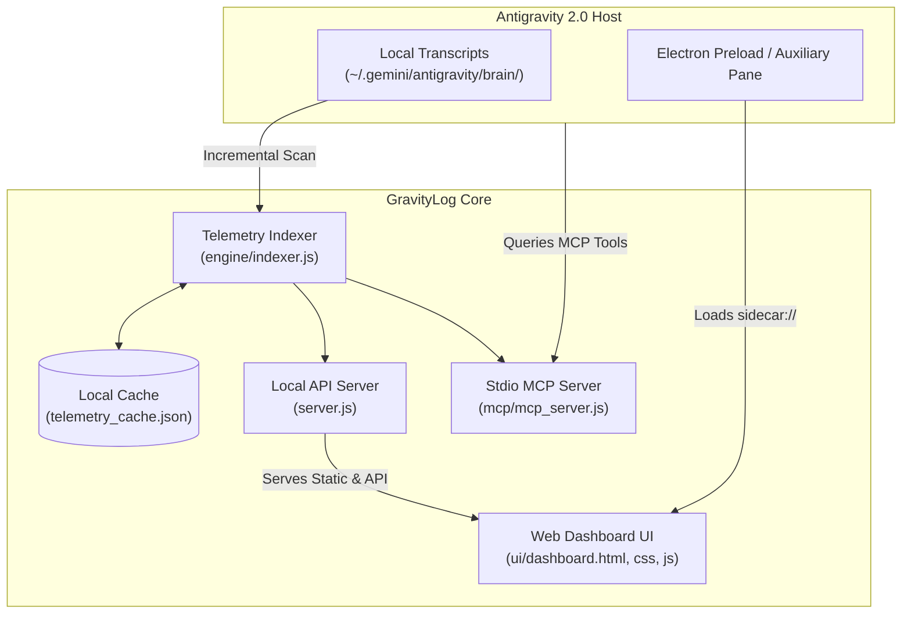

<p align="center">
  
</p>

<h1 align="center">GravityLog</h1>

<p align="center">
  <b>Native Usage Analytics, Token Consumption Tracker & 365-Day Activity Heatmap for Antigravity 2.0</b>
</p>

<p align="center">
  <a href="#license"></a>
  <a href="https://nodejs.org/"></a>
  <a href="#antigravity-compatibility"></a>
  <a href="#model-context-protocol-mcp"></a>
  <a href="#platform"></a>
</p>

---

## 🚀 Overview

**GravityLog** is a lightweight, production-grade usage analytics engine and native UI extension designed specifically for the **Google Antigravity 2.0** desktop app on Windows.

It delivers real-time visibility into your AI coding workflows by aggregating local conversation transcripts, token counters, model distributions, and daily habits into a clean, Google-styled dashboard that integrates directly into Antigravity's chrome, sidebar panes, and AI agent skills.

---

## ✨ Features

- **🌓 Dual-Theme System**: Sleek Google Material 3 dark mode by default with instant light mode toggle.
- **📊 Bento KPI Summary**: Real-time totals for requests, user messages sent, explicit token input/output breakdown, top model, and active streaks.
- **📅 365-Day Activity Heatmap**: GitHub-style 52-week calendar with 5 intensity levels, interactive hover tooltips, and timeframe filters (`today`, `1w`, `30d`, `90d`, `all`).
- **🥧 Model Distribution**: Segmented visual progress bar and ranked breakdown of per-model request counts, token volumes, and share percentages.
- **⚡ Fast Incremental Telemetry**: Offline background indexer caching conversation transcripts with zero performance impact.
- **🔄 30s Auto-Refresh**: Live automatic polling every 30 seconds with interactive reload animation feedback.
- **📸 One-Click Screenshot Export**: Instant 2x retina PNG capture auto-saved directly to your Windows Downloads folder and clipboard.
- **🤖 Native MCP Server**: Built-in Model Context Protocol tools for AI agents to inspect your usage statistics through natural chat.

---

## 🏛️ Architecture



---

## 📥 Installation & Usage

### 1. Install GravityLog

1. Clone or download this repository:
   ```bash
   git clone https://github.com/your-username/GravityLog.git
   cd GravityLog
   ```

2. Run the automated PowerShell installer:
   ```powershell
   powershell -ExecutionPolicy Bypass -File install.ps1
   ```
   *Or with NPM:*
   ```bash
   npm run install-plugin
   ```

3. **Enable the Extension in Antigravity:**
   > **Important:** Open Antigravity, go to the **Customizations** tab &rarr; **Installed Plugins** &rarr; find **GravityLog** and ensure the UI extension toggle is **Enabled**. You must enable it here, otherwise it will not show in the right sidebar pane.

---

### 2. How to Open the Dashboard

- **Right Sidebar Pane:** Click the **menu / 3 dots (`...`)** in the top right of the Antigravity window &rarr; select **Extensions** &rarr; click **GravityLog** to open the sidebar.
- **Direct Sidecar URL:** You can also open the sidecar pane directly via `sidecar://antigravity-analytics/usage-analytics/` or `sidecar://usage-analytics/`.
- **Standalone Web URL:** Access the dashboard in any browser at `http://localhost:49221` while Antigravity is running.
- **Keyboard Shortcut:** Press `Ctrl + Shift + U` to toggle the native modal overlay from anywhere inside the app.

---

## 🤖 Model Context Protocol (MCP)

GravityLog registers a local MCP server that allows Antigravity AI agents to understand your usage habits and answer questions about your token consumption.

### Available Tools:

| Tool Name | Parameters | Description |
|---|---|---|
| `get_usage_metrics` | `timeframe` (`30d`, `90d`, `1y`, `all`), `preview` (`boolean`) | Returns total request count, token breakdown (input, output, thinking), streaks, and primary model. |
| `get_activity_heatmap` | `preview` (`boolean`) | Returns the 365-day contribution matrix mapping daily buckets to levels 0-4. |
| `get_model_breakdown` | `preview` (`boolean`) | Returns ranked AI models with token and request share percentages. |
| `export_telemetry` | `format` (`json` or `csv`), `preview` (`boolean`) | Returns telemetry data formatted as JSON or CSV text. |

### Sample Prompts for Antigravity:
- *"Show my GravityLog usage analytics and token metrics"*
- *"How many prompt tokens did I consume this week?"*
- *"Export my monthly AI usage to CSV"*

---

## 🗑️ Uninstallation

To remove GravityLog cleanly:
```powershell
powershell -ExecutionPolicy Bypass -File uninstall.ps1
```
*Or with NPM:*
```bash
npm run uninstall-plugin
```

This terminates the background service, disables the plugin in `config.json`, cleans sidecar registrations, and restores any patched Electron archives safely.

---

## 📄 License

Distributed under the **MIT License**. See [`LICENSE`](./LICENSE) for more details.

---

<p align="center">
  Crafted with ❤️ for the Antigravity Community.
</p>
